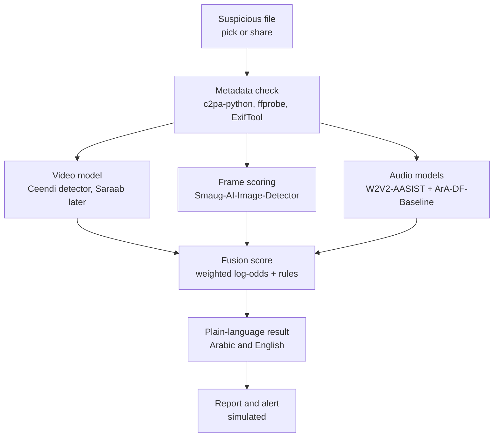

<div align="center">

# 🛡️ Deep AI

### Is this video, photo or voice message real? Check it the moment it arrives.

**Team KLASSIFY** · UAE Hackathon 2026 · Youth Track · Challenge #40: *Building Trust in Digital Content*


</div>

> **Working title.** "Deep AI" is a placeholder name.
> **Prototype status:** the screens and flow are built. The detection results shown in the app are **demo data** until the backend is connected (see [Status](#-status)).

---

## 🎯 The problem

Cloned voices of relatives, fake videos of officials and edited images are now cheap to make, and people usually have only seconds to decide whether to trust them. Detection tools exist, but they are scattered, technical, mostly built for English content, and not available at the moment someone receives a suspicious message.

## 💡 Our idea

A **free, consumer-first app** that lets anyone check a suspicious file at the moment they receive it, and get a **plain answer in Arabic or English** with clear next steps.

1. **Pick** a video, photo or voice message (sharing straight from WhatsApp is planned).
2. **We check it** for signs of editing.
3. **You get a clear result:** *Likely fake*, *Not sure*, or *No signs of manipulation found*, plus what to do next (for example, call the person on a number you already know).
4. **Report it** with one tap (simulated in this prototype).

The app never says "100% real" or "100% fake". Results are estimates and can be wrong, and the app says so.

## 🚦 Status

| Area | State |
|---|---|
| Mobile UI (home, checking, result, report sheet) | ✅ Built |
| Arabic / English with right-to-left layout | ✅ Built (Arabic wording needs native review) |
| Analysis | 🧪 **Demo data**: cycles through the three outcomes |
| Report to authorities | 🧪 **Simulated**: nothing is sent anywhere |
| Backend (FastAPI) and detection models | 📝 Planned |
| Share-to-app from WhatsApp | 📝 Planned (needs a development build) |
| Open the app by voice | 📝 Planned (uses the phone's assistant: "Hey Siri / Hey Google, open the app") |
| Saraab integration | 📝 Scaling idea only. Not released, not integrated |

## 🧠 Planned detection pipeline



**Why several signals:** no single detector is reliable on its own. We combine independent checks and show **Not sure** when they disagree.

**Fusion (starting weights are guesses, to be fitted on a labeled test set):**

```
l_i   = ln(p_i / (1 - p_i))          # each detector's fake score, clipped to [0.02, 0.98]
S     = Σ w_i · l_i                  # video 0.45, frames 0.30, audio 0.25 (renormalized if one is missing)
P     = 1 / (1 + e^-S)
Likely fake            P ≥ 0.75
No signs found         P ≤ 0.25 and at least two signals agree
Not sure               otherwise, or if scores differ by more than 0.4
```

A valid "AI-generated" content credential overrides the score. A valid camera or newsroom credential lowers it. Missing metadata changes nothing.

### Limits we are upfront about

- Recent research (the DF26 benchmark, 2026) found that open detectors perform close to chance on the newest fully AI-generated video. Our video model is best at older face-swap fakes. **"No signs found" does not prove a file is genuine.**
- Models were mostly trained on non-local data. We plan to test on Arabic and Gulf content and report the false-alarm rate honestly.
- **Check model licenses before any commercial use.** For example, the Ceendi video detector is licensed for research and education only.
- The report feature is a **concept**. A real version needs an agreement with an actual receiving authority.
- Privacy goals for the real backend (design goals, **not yet implemented**): do not store uploads, delete files after analysis, share a file in a report only with consent.

## 🧰 Tech stack

- **App:** Expo (React Native), Expo Router, TypeScript
- **Backend (planned):** Python, FastAPI
- **Models (planned):** Ceendi video detector, Smaug-AI-Image-Detector (SigLIP2 as lighter backup), W2V2-AASIST, ArA-DF-Baseline (Arabic)
- **Metadata (planned):** c2pa-python, ffprobe, ExifTool

## 🚀 Run it

```bash
npm install
npx expo install expo-document-picker
npx expo start
```

- **Quick UI test:** open the project in [Expo Go](https://expo.dev/go) on your phone.
- **Share-from-WhatsApp and other native features** need a [development build](https://docs.expo.dev/develop/development-builds/introduction/), not Expo Go.
- **Web:** press `w` in the terminal.

### Settings you will touch

| File | What |
|---|---|
| `src/lib/theme.ts` | `IS_MOCK` (set to `false` when the backend is connected), `FEATURES.shareTip` (turn on only when share-to-app works) |
| `src/lib/analyze.ts` | `API_URL` and the real `/analyze` call (sketched in comments) |
| `src/lib/i18n.tsx` | All English and Arabic text, and the app name |

## 🗂️ Project structure

```
src/
├── app/
│   ├── _layout.tsx      # stack navigation + language provider
│   ├── index.tsx        # home: choose a file to check
│   └── result.tsx       # progress, verdict, what we found, next steps, report sheet
├── components/
│   └── ui.tsx           # text, rows, buttons, cards (all right-to-left aware)
└── lib/
    ├── analyze.ts       # demo analysis + planned backend call
    ├── i18n.tsx         # English / Arabic strings
    └── theme.ts         # colors, spacing, flags
```

## 🗺️ Roadmap

- [ ] FastAPI backend with `/analyze`, returning `{ verdict, signals }`
- [ ] Metadata and C2PA check
- [ ] Audio extraction and voice models (global + Arabic)
- [ ] Video model and frame scoring, tested on public datasets
- [ ] Fit fusion weights and report real false-alarm rates
- [ ] Share-to-app from WhatsApp, voice launch
- [ ] Pilot plan with a real stakeholder, plus a dashboard for impersonated organizations
- [ ] Swap in Saraab if and when it becomes available to us

## 👥 Meet Team KLASSIFY

<!-- Replace the placeholders below. Use each person's GitHub username for the avatar. Add or remove rows as needed. -->

<div align="center">

<table>
  <tr>
    <td align="center" width="180">
      <br>
      <b>Your Name</b><br>
      <sub>Your role</sub><br>
      <sub>🔗 <a href="https://github.com/USERNAME1">@USERNAME1</a></sub>
    </td>
    <td align="center" width="180">
      <br>
      <b>Your Name</b><br>
      <sub>Your role</sub><br>
      <sub>🔗 <a href="https://github.com/USERNAME2">@USERNAME2</a></sub>
    </td>
    <td align="center" width="180">
      <br>
      <b>Your Name</b><br>
      <sub>Your role</sub><br>
      <sub>🔗 <a href="https://github.com/USERNAME3">@USERNAME3</a></sub>
    </td>
    <td align="center" width="180">
      <br>
      <b>Your Name</b><br>
      <sub>Your role</sub><br>
      <sub>🔗 <a href="https://github.com/USERNAME4">@USERNAME4</a></sub>
    </td>
  </tr>
</table>

*Four students. One goal: help people in the UAE trust what they see and hear.*

</div>

## 🙏 Credits and references

- **UAE Hackathon 2026** and the challenge profile *Building Trust in Digital Content* (Community Challenge #2). This project is a student entry and is **not endorsed by** any government entity named in the challenge.
- **Saraab**, the Dubai Electronic Security Center's deepfake detection model, announced with a planned open-source release. It is our scaling idea; we do not have access to it.
- **Deepy**, an existing UAE deepfake-verification platform, for showing that detection already exists locally. Our focus is the consumer flow around it.
- Open-source models and datasets by their respective authors: Ceendi, abacusai (Smaug), prithivMLmods (SigLIP2), W2V2-AASIST, ArabicSpeech (ArA-DF), ArFake, DF26, and the C2PA project. Please follow each model's license.
